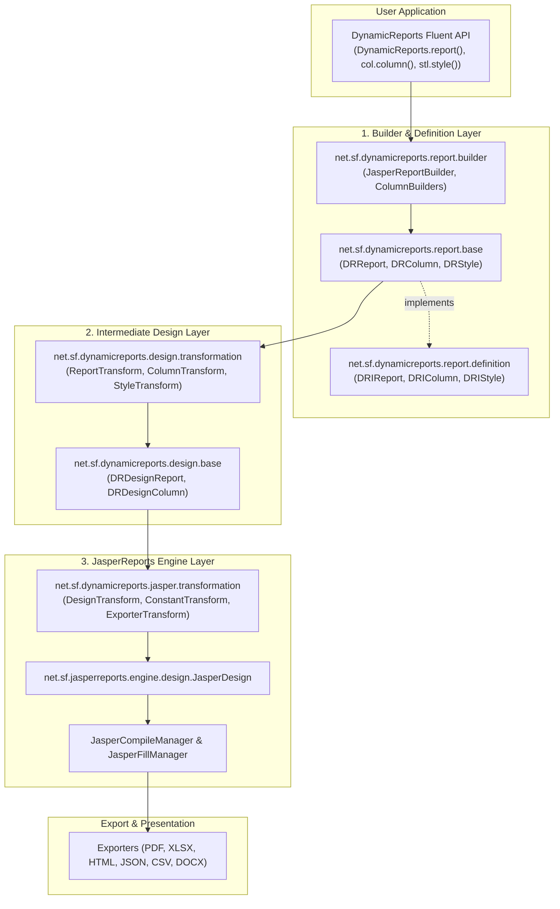

# Agent Guide for DynamicReports

Welcome to the **DynamicReports** repository. This document provides autonomous agents and developers with essential context, architectural understanding, build/test workflows, and code quality conventions required to contribute effectively.

---

## 1. Repository Overview

[DynamicReports](https://github.com/dynamicreports/dynamicreports) is an open-source Java reporting library built on top of [JasperReports](https://community.jaspersoft.com/). It provides a fluent, programmatic Java builder API that eliminates the need for visual report designers (like Jaspersoft Studio) to define and generate complex reports.

### Tech Stack & Toolchain
- **Language**: Java (Target bytecode compatibility: Java 8+; Default development/CI toolchain: JDK 17).
- **Reporting Engine**: JasperReports `7.0.7` (upgraded from 6.x).
- **Build System**: Apache Maven 3.8+ (Maven wrapper `./mvnw` included).
- **XML / Marshalling**: Jakarta XML Binding (`jakarta.xml.bind-api:4.0.5`), JAXB Core & Impl.
- **Logging**: SLF4J (`logback-classic`, `log4j-to-slf4j`, `jul-to-slf4j`).
- **Testing**: JUnit 5 (`junit-jupiter-api:5.14.3`), HSQLDB in-memory database for testing.

---

## 2. Project Structure & Modules

The repository is structured as a Maven multi-module project. Note the distinction between active reactor modules and standalone modules:

```
dynamicreports/
├── pom.xml                       # Parent POM (version 7.0.8-SNAPSHOT)
├── compile.sh                    # Helper script for JDK 17 fast build (-DskipTests)
├── deploy.sh                     # Deployment script to private Artifactory
├── release.sh                    # Maven release plugin workflow script
├── src/etc/
│   ├── checkstyle.xml            # Checkstyle rule definition
│   ├── license_header.txt        # Required header for all source files
│   └── header_definition.xml     # Mycila license plugin configuration
├── dynamicreports-core/          # [ACTIVE] Core reporting engine & builder API
├── dynamicreports-examples/      # [ACTIVE] Example reports demonstrating library features
├── dynamicreports-adhoc/         # [STANDALONE/LEGACY] Ad-hoc configuration module (v6.20.1)
└── dynamicreports-googlecharts/  # [STANDALONE/LEGACY] Google Charts integration (v6.20.1)
```

### Active Reactor Modules (`pom.xml`)
1. **`dynamicreports-core`**: The main library artifact containing the fluent builder API, intermediate design representations, JasperReports transformers, and export handlers.
2. **`dynamicreports-examples`**: Comprehensive suite of runnable report examples (PDF, Excel, charts, crosstabs, barcodes, subreports).

> [!NOTE]
> `dynamicreports-adhoc` and `dynamicreports-googlecharts` were decoupled from the default Maven reactor during the JasperReports 7.0 upgrade and remain at version `6.20.1`. Do not add them back to root `pom.xml` unless instructed.

---

## 3. Architecture & Design Flow

DynamicReports follows a 3-layer architecture to decouple report configuration from JasperReports internals:



### Key Packages & Responsibilities
- **`net.sf.dynamicreports.report.builder`**: Static facades and builders (`DynamicReports`, `DynamicReports.cmp`, `DynamicReports.col`, `DynamicReports.stl`, etc.).
- **`net.sf.dynamicreports.report.base`**: POJO implementations representing report elements (`DRReport`, `DRBand`, `DRTextField`, `DRChart`).
- **`net.sf.dynamicreports.design.transformation`**: Validates report rules and converts `DRReport` into `DRDesignReport`.
- **`net.sf.dynamicreports.jasper.transformation`**: Converts `DRDesignReport` into native JasperReports `JasperDesign` and configures JR elements.
- **`net.sf.dynamicreports.jasper.builder.export`**: Exporter configurations and adapters (`JasperPdfExporterBuilder`, `JasperXlsxExporterBuilder`, etc.).

---

## 4. Build & Test Commands

### Prerequisites
Ensure JDK 17 is active in your terminal environment:
```bash
export JAVA_HOME=/usr/lib/jvm/java-17-openjdk-amd64
export PATH=$JAVA_HOME/bin:$PATH
```

### Standard Commands

| Action | Command |
|---|---|
| **Build without tests** | `./compile.sh` or `mvn clean install -DskipTests` |
| **Run all tests** | `mvn test` |
| **Compile tests only** | `mvn test-compile` |
| **Run single test class** | `mvn test -pl dynamicreports-core -Dtest=BooleanColumnPosition1Test` |
| **Run single test method** | `mvn test -pl dynamicreports-core -Dtest=BooleanColumnPosition1Test#test` |
| **Run tests across reactor** | `mvn test -Dtest=BooleanColumnPosition1Test -Dsurefire.failIfNoSpecifiedTests=false` |
| **Run Checkstyle validation** | `mvn checkstyle:check` |

> [!WARNING]
> Because `dynamicreports-examples` does not have unit tests in `src/test/java`, running `mvn test -Dtest=SomeTest` without `-pl dynamicreports-core` will cause surefire to fail on `dynamicreports-examples` unless `-Dsurefire.failIfNoSpecifiedTests=false` is provided. Always scope single tests to `-pl dynamicreports-core`.

---

## 5. Coding Standards & Checkstyle

Code quality is enforced via `maven-checkstyle-plugin` using [`src/etc/checkstyle.xml`](file:///home/sugree/work/git/isc/src/dynamicreports/src/etc/checkstyle.xml).

### Non-Negotiable Rules
1. **No Wildcard Imports**: `AvoidStarImport` has severity `error`. Never write `import net.sf.dynamicreports.report.builder.*;`. Always import explicit types.
2. **Indentation & Formatting**:
   - Indentation must be **4 spaces**.
   - **No Tab characters** (`FileTabCharacter` severity `error`).
   - Braces required for all control blocks (`NeedBraces` severity `error`).
   - Opening brace on same line (`LeftCurly` severity `error`).
3. **License Header**:
   - Every `.java` file must begin with the header located at [`src/etc/license_header.txt`](file:///home/sugree/work/git/isc/src/dynamicreports/src/etc/license_header.txt).
4. **Javadoc**:
   - Protected and public classes and methods require Javadoc comments.
   - Generic types must include `@param <T>` tags.
5. **Checkstyle Violation Threshold**:
   - The build allows a maximum of 40 warnings across grandfathered files (`checkstyle.config.maxAllowedViolations=40`). Never introduce changes that push the violation count over this threshold.

---

## 6. Guidelines for Making Changes

When implementing features or bug fixes:
1. **Follow the 3-Layer Flow**:
   - If adding a report attribute, update:
     1. Interface in `net.sf.dynamicreports.report.definition`
     2. Model class in `net.sf.dynamicreports.report.base`
     3. Builder class in `net.sf.dynamicreports.report.builder`
     4. Design class in `net.sf.dynamicreports.design.base` / `design.definition`
     5. Transformation in `net.sf.dynamicreports.design.transformation`
     6. JasperReports mapping in `net.sf.dynamicreports.jasper.transformation`
2. **Verify with Unit Tests**:
   - Look at existing tests in `dynamicreports-core/src/test/java/net/sf/dynamicreports/test/jasper/` for patterns (e.g., configuring a report, exporting, and verifying JasperPrint output).
3. **Keep Exporters in Sync with JasperReports 7.0**:
   - JasperReports 7.0 moved or refactored several export configuration classes. Check `ExporterTransform.java` and `Exporters.java` for reference implementations before touching export logic.
